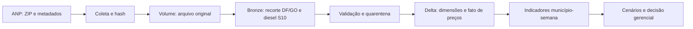
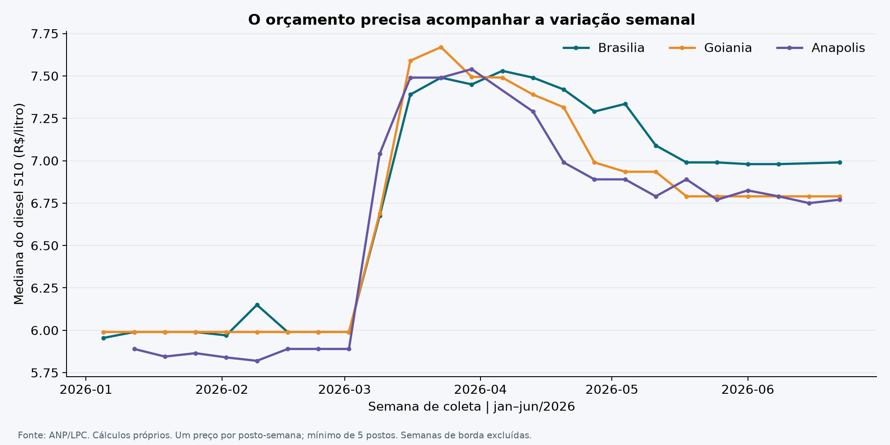
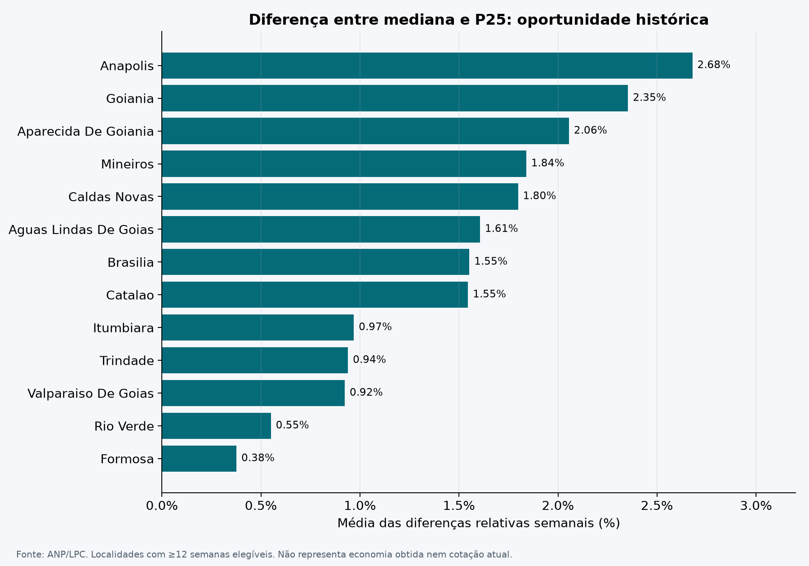
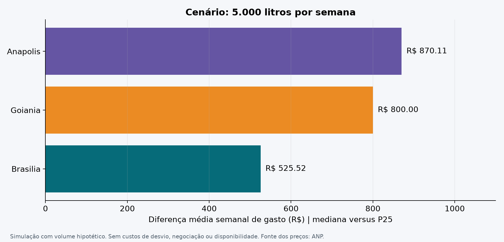

# PSP2 — Planejamento de abastecimento de frotas

**MVP de inteligência de custos com dados públicos da ANP**  
Universidade de Brasília • Engenharia de Produção  
Professor: **André Luiz Marques Serrano**  
Período analisado: **janeiro a junho de 2026** • Coleta: **04/11/2026**

> **Situação da entrega:** pipeline executado e resultados verificados em Python local. Notebook de execução e persistência no Databricks disponível. A comprovação da execução na nuvem ainda está pendente; não se deve confundir resultados locais com evidência de tabelas Delta persistidas. Consulte [evidências](evidencias/README.md).

## Resumo executivo

Este projeto transforma observações públicas de preços de diesel S10 em referências semanais para orçamento e cotação de pequenas frotas no Distrito Federal e em Goiás. O recorte contém **3.789 observações, 296 postos e 17 localidades**. A análise principal reúne **318 pares município-semana** com pelo menos cinco postos e semanas completas dentro do semestre.

A hipótese de encontrar diferença entre mediana e primeiro quartil (P25) de pelo menos 3% em metade das semanas **não foi atendida em nenhuma das 13 localidades com cobertura suficiente**. Isso não elimina oportunidades pontuais: Anápolis apresentou diferença relativa semanal média de 2,68%, Goiânia de 2,35% e Brasília de 1,55%. A conclusão é apoiar cotação local e revisão de orçamento, sem prometer uma economia uniforme de 3%.

Os cenários usam volumes hipotéticos. Não há empresa contratante, consumo real de frota, cotação atual, comprovação de economia ou validação com usuários.

## 1. Problema, objetivo e experimento

**Problema:** como um gestor de operações pode avaliar referências de preço e planejar o gasto com combustível sem depender apenas do preço observado no último abastecimento?

**Objetivo:** construir e executar um pipeline que colete dados oficiais, aplique regras verificáveis de qualidade, organize um modelo dimensional e produza indicadores que apoiem orçamento e seleção de postos para cotação.

**Público-alvo:** responsável por compras ou operações de uma pequena frota a diesel. O usuário precisa decidir quando revisar o orçamento e onde pesquisar condições de abastecimento dentro de sua área de operação.

O [registro do objetivo](docs/01_objetivo.md) foi escrito antes da coleta e preserva as perguntas originais:

1. Como os preços variaram semanalmente nas localidades analisadas?
2. Onde houve maior dispersão de preços entre os postos pesquisados?
3. Quais postos apresentaram preços abaixo da mediana local com maior frequência e cobertura suficiente de observações?
4. Qual seria a diferença de gasto em cenários de consumo, comparando a mediana com uma referência de preço inferior?
5. Que regras de acompanhamento e revisão do orçamento podem ser propostas a partir dos resultados?

**Hipótese:** diferenças recorrentes entre mediana e P25 justificam pesquisar fornecedores antes de abastecer. Métrica: `(mediana − P25) / mediana`. Critério prévio de interesse: diferença ≥3% em pelo menos 50% das semanas elegíveis. O valor de 3% é uma decisão experimental, não uma norma do setor. Durante o desenvolvimento foi acrescentado o mínimo de 12 semanas para avaliar uma localidade, evitando conclusões com pouca cobertura; essa decisão está explicitada no [modelo](catalogo/MODELO.md).

## 2. Busca, coleta e licenciamento

Após definir o problema, selecionou-se a **Série Histórica de Preços de Combustíveis da ANP**, pois oferece preço de venda, data, identificação do estabelecimento, localização e combustível. O uso de uma fonte pública dispensa inventar dados de uma empresa.

Fonte primária: [página oficial da série](https://www.gov.br/anp/pt-br/centrais-de-conteudo/dados-abertos/serie-historica-de-precos-de-combustiveis). Download: [ZIP do primeiro semestre de 2026](https://www.gov.br/anp/pt-br/centrais-de-conteudo/dados-abertos/arquivos/shpc/dsas/ca/ca-2026-01.zip). Definições: [metadados da ANP](https://www.gov.br/anp/pt-br/centrais-de-conteudo/dados-abertos/arquivos/shpc/metadados-serie-historica-precos-combustiveis-1.pdf).

| Item | Resultado da coleta |
|---|---:|
| Formato original | ZIP contendo CSV separado por ponto e vírgula |
| Codificação | UTF-8 |
| Tamanho do ZIP | 8.488.624 bytes |
| Registros da fonte nacional, todos os combustíveis | 422.418 |
| Registros de diesel S10 em DF/GO | 3.789 |
| Datas observadas no recorte | 02/01/2026 a 30/06/2026 |
| Postos distintos (CNPJ) | 296 |
| Localidades distintas (UF + município) | 17 |

O [registro de auditoria](resultados/auditoria.json) documenta URL, arquivo interno, hash SHA-256, horário e contagens. Reexecuções podem encontrar revisões da fonte: compare o hash antes de comparar resultados.

O rodapé da página ANP declara CC BY-ND 3.0; os metadados não especificam outra licença para o conjunto. Por cautela, o GitHub não redistribui o ZIP nem os microdados transformados. Publica scripts, documentação autoral e análises agregadas com atribuição. Consulte [licença e procedência dos dados](docs/LICENCA_DADOS.md). A [licença MIT](LICENSE) cobre o código, não a fonte ANP.

## 3. Arquitetura, modelagem e carga



O esquema estrela contém `fato_preco`, `dim_data`, `dim_localidade`, `dim_posto` e `dim_produto`. O grão da fato é uma observação por CNPJ/produto/data. A dimensão posto preserva versões dos atributos descritivos; análises por estabelecimento usam CNPJ, evitando contar versões como novos postos.

- [Diagrama, chaves, linhagem e regras](catalogo/MODELO.md).
- [Catálogo de atributos e domínios](catalogo/CATALOGO.md).
- [Pipeline Python](scripts/pipeline.py).
- [Notebook completo para Databricks](notebooks/PSP2_Abastecimento.ipynb).
- [Consultas SQL](scripts/consultas.sql).

O ETL converte datas e decimais, normaliza CNPJ como texto, remove duplicatas exatas e interrompe o processamento se houver conflitos na chave natural. Valores inválidos são separados em quarentena. Uma faixa de R$ 2–15/litro funciona apenas como alerta de plausibilidade. Preço de compra não é imputado.

No Databricks, o notebook cria `psp2_abastecimento.arquivos` como Volume no catálogo atual e persiste Bronze, dimensões, fato, qualidade, indicadores e cenários como tabelas Delta. Em reexecuções, sobrescreve somente as tabelas desse schema de projeto. Releitura, contagens, unicidade e integridade referencial são verificadas após a gravação. A coleta pode ser automática por URL ou por envio do ZIP oficial ao Volume se a Free Edition bloquear a saída de rede.

## 4. Qualidade dos dados

A [análise por atributo](resultados/qualidade_atributos.csv) cobre todos os 16 campos de origem. O fato de não haver falhas nas regras principais não comprova que os preços coincidiam com os praticados no balcão: esta acurácia externa não foi verificada.

| Dimensão | Verificação e resultado |
|---|---|
| Completude | `complemento`: 1.219 nulos (32,17%); `preco_compra`: 3.789 nulos (100%). Demais campos sem nulos no recorte. |
| Unicidade | 0 duplicatas exatas; 0 conflitos CNPJ/produto/data. |
| Consistência | UF no recorte e região CO coerentes; um único produto e unidade. |
| Conformidade | 0 datas, CNPJs sintáticos, preços ou unidades inválidos nas regras implementadas. |
| Plausibilidade | Preços entre R$ 5,39 e R$ 8,73; nenhum fora da faixa de alerta. |
| Atualidade | Estudo histórico de um semestre fechado. Inadequado como cotação de novembro/2026. |
| Cobertura | 13 localidades com ≥12 semanas elegíveis; 4 com cobertura insuficiente para a conclusão principal. |

Segundo os metadados, preço de compra foi publicado somente até agosto de 2020. Portanto, sua ausência é estrutural e impede calcular margem de revenda. Complemento vazio não invalida uma observação de preço.

As localidades com cobertura insuficiente são Goiatuba (6 semanas), Luziânia (3), Morrinhos (3) e Porangatu (9). Seus resultados exploratórios permanecem no arquivo, mas não sustentam a avaliação da hipótese. Semanas sem pelo menos cinco postos e semanas de borda do semestre não são imputadas.

## 5. Resultados e discussão

### Q1 — Como os preços variaram?



Em Brasília, a mediana passou de R$ 5,955 na primeira semana elegível para R$ 6,99 na última, tendo alcançado R$ 7,53. Em Goiânia, os valores inicial e final foram R$ 5,99 e R$ 6,79, com máximo de R$ 7,67. Em Anápolis, R$ 5,89 e R$ 6,77, com máximo de R$ 7,54. O gráfico mostra mudança relevante do patamar durante o semestre; não identifica sua causa.

**Decisão apoiada:** atualizar a referência de orçamento semanalmente. Usar um valor fixo de janeiro para o semestre inteiro não acompanharia as medianas observadas. Alterações na composição da amostra também podem afetar a série.

### Q2 — Onde houve maior dispersão?

Entre localidades com cobertura suficiente, Anápolis teve amplitude interquartil semanal média de **R$ 0,402/litro**, Goiânia de **R$ 0,371/litro** e Brasília de **R$ 0,295/litro**. IQR mede P75 − P25 e é distinto do indicador de oportunidade mediana − P25.



A diferença relativa semanal média entre mediana e P25 foi de 2,68% em Anápolis, 2,35% em Goiânia e 1,55% em Brasília. Formosa apresentou 0,38%. Isso sugere intensidades diferentes para pesquisa local de preços; não justifica deslocar veículos entre cidades sem considerar rota e custo adicional.

**Evidência:** [resumo por localidade](resultados/resumo_localidades.csv) e [indicadores por semana](resultados/indicadores_semanais.csv). As semanas disponíveis diferem entre localidades; as médias não são ponderadas por litros vendidos.

### Q3 — Quais postos ficaram abaixo da mediana com frequência?

**104 postos** atenderam ao mínimo de 12 semanas e 75% de cobertura local. Houve um posto em Goiânia abaixo da mediana em 25 de 25 semanas elegíveis observadas, com desconto relativo médio de 5,15%; um posto em Anápolis ficou abaixo em 22 de 22 semanas observadas, cobrindo 22 das 23 semanas locais, com desconto médio de 4,42%.

O notebook gera o ranking identificável no ambiente de análise. Para evitar republicar o cadastro de microdados, o GitHub inclui apenas o [resumo agregado do ranking](resultados/resumo_ranking.csv). A identificação operacional pode ser consultada na tabela `ranking_postos` gerada na nuvem, relacionada ao CNPJ da dimensão de postos.

**Decisão apoiada:** formar uma lista inicial para novas cotações, condicionada a disponibilidade, desvio de rota, capacidade e condições comerciais. O ranking é retrospectivo e selecionado na mesma amostra em que é avaliado; não demonstra persistência futura. A próxima etapa deve testar os candidatos em semanas posteriores.

### Q4 — Qual a diferença de gasto simulada?

Usando **5.000 litros por semana**, a diferença média entre pagar a mediana e pagar o P25 seria:

| Localidade | Semanas elegíveis | Diferença média por litro | Diferença de gasto por semana |
|---|---:|---:|---:|
| Anápolis | 23 | R$ 0,1740 | R$ 870,11 |
| Goiânia | 25 | R$ 0,1600 | R$ 800,00 |
| Brasília | 24 | R$ 0,1051 | R$ 525,52 |



Fórmula: `litros hipotéticos × (mediana semanal − P25 semanal)`. O [arquivo de cenários](resultados/cenarios.csv) inclui 1.000, 5.000 e 10.000 litros por semana. P25 é um quantil interpolado, não necessariamente uma oferta que possa ser contratada. O cenário é um benchmark de orçamento, sem custos de deslocamento ou implantação. Não é economia obtida nem promessa de resultado.

### Q5 — Que política operacional propor?

| Ação proposta | Responsável funcional | Indicador | Regra inicial de acompanhamento |
|---|---|---|---|
| Atualizar referências locais semanalmente | Analista de operações | Cobertura e mediana | Publicar apenas semanas elegíveis; sinalizar falta de dados. |
| Pesquisar postos candidatos na rota existente | Compras | Preço cotado e custo total | Comparar cotação atual, deslocamento e condições, sem contratar só pelo ranking. |
| Revisar orçamento | Gestor de frota | Desvio entre preço efetivo e referência | Investigar desvio >3% por duas semanas; regra proposta, ainda não validada. |
| Medir um piloto | Operações e compras | Custo por litro e por km; litros reais | Comparar quatro semanas de operação com referência definida antes do piloto. |
| Auditar a atualização | Responsável pelos dados | Nulos, duplicatas, chaves e cobertura | Interromper cálculo em conflito de chave; manter registro de execução. |

O piloto não foi realizado. Uma comparação simples antes/depois também seria afetada por variações de mercado; por isso a avaliação futura deve controlar localidade, período, produto e padrão de operação.

### Discussão geral e hipótese

**Nenhuma das 13 localidades com cobertura suficiente cumpriu o critério de diferença ≥3% em pelo menos metade das semanas.** Em Anápolis, ele ocorreu em 34,78% das semanas, em Goiânia em 20% e em Brasília em 8,33%. A hipótese operacional, tal como definida, não recebeu suporte no recorte; nas quatro localidades com baixa cobertura, a conclusão é insuficiente.

Há utilidade potencial no acompanhamento e em cotações seletivas, mas os dados não sustentam uma promessa generalizada de economia de 3%. Esse resultado negativo orienta reduzir o escopo da proposta comercial e testar valor com usuários antes de investir em uma solução contínua.

## 6. Viabilidade do MVP

**Técnica:** o pipeline local foi executado; a arquitetura de nuvem usa notebook, Volume e Delta. A confirmação de execução cloud deve constar nas evidências, e não ser presumida a partir do código.

**Econômica:** o experimento foi desenhado para a Free Edition, sujeita a quotas e restrições. O custo de infraestrutura pode ser zero enquanto permanecer dentro dessas condições; isso não equivale a custo operacional total zero. Cenário gerencial ilustrativo: 1 hora semanal de atualização/conferência a R$ 50/h = R$ 50 por semana, sem incluir implantação ou deslocamento. Para 5.000 litros, o ponto de equilíbrio desse custo isolado seria R$ 0,01/litro. A taxa horária é hipotética, não pesquisada. Não se afirma que o potencial simulado será capturado.

**Desejabilidade:** a relação entre perguntas e decisões é explícita, mas não houve entrevista, piloto ou teste com gestor de frota. Permanece uma hipótese a validar.

## 7. Reproduzir

### Local

```bash
python -m pip install -r requirements.txt
python scripts/pipeline.py --zip data/ca-2026-01.zip --out resultados
python scripts/verificar.py
python scripts/visualizar.py
```

O pipeline baixa o ZIP se ele não existir. A verificação gera o resumo público do ranking e o [registro de validação local](resultados/validacao_local.json): chaves, integridade referencial, cardinalidade dos joins, quantis, cobertura, aritmética dos cenários e sintaxe do notebook. Os microdados e tabelas locais gerados são ignorados no versionamento. Não publicar credenciais, tokens ou arquivos de configuração pessoal.

### Databricks

Importe [PSP2_Abastecimento.ipynb](notebooks/PSP2_Abastecimento.ipynb), selecione Serverless e execute todas as células. O [guia de execução](docs/EXECUTAR_DATABRICKS.md) explica como enviar o ZIP ao Volume se o download for bloqueado. Ao concluir, execute a última célula em nova sessão para confirmar que as tabelas continuam acessíveis.

Referência técnica: [limitações da Free Edition](https://docs.databricks.com/aws/en/getting-started/free-edition-limitations). Não se usa DBFS root como armazenamento do projeto.

## 8. Autoavaliação técnica

As cinco perguntas foram tratadas: Q1 e Q2 com indicadores semanais; Q3 com ranking e filtros de cobertura; Q4 por simulação declarada; Q5 por proposta de gestão. Não foram demonstradas economia realizada, desejabilidade ou causalidade. A execução na nuvem somente estará concluída quando houver as evidências correspondentes.

As principais dificuldades foram interpretar a ausência estrutural do preço de compra, evitar peso indevido para postos com mais coletas, lidar com cobertura desigual e preparar persistência compatível com a Free Edition. O primeiro teste local também identificou um caso de quarentena vazia no pandas, corrigido antes da execução final.

Se o projeto fosse reiniciado, seria planejado um painel de postos comparáveis ao longo do tempo e uma validação temporal separada do período usado para selecionar candidatos. Também seriam definidos com um gestor real o consumo, as rotas e o custo de desvio. Para uso contínuo: carga incremental, agendamento, alertas de qualidade, manutenção cadastral, registro de custos e piloto prospectivo.

O desenvolvimento contou com assistência de IA na programação e na redação. Esta seção descreve a avaliação técnica do artefato; a reflexão pessoal do aluno e seu domínio das escolhas devem ser conferidos antes da entrega.

## 9. Organização e checklist

```text
README.md                 documento principal de avaliação
notebooks/                pipeline executável em Databricks
scripts/                  ETL, gráficos e consultas
catalogo/                 domínios, modelo e linhagem
docs/                     objetivo, execução e licença dos dados
resultados/               auditoria e análises agregadas
figuras/                  gráficos citados na discussão
evidencias/               estado e comprovação da execução cloud
```

- [x] Objetivo e perguntas preservados.
- [x] Fonte, coleta, regras e limitações documentadas.
- [x] Modelo, catálogo e linhagem documentados.
- [x] Qualidade por atributo e análise executadas localmente.
- [x] Resultados negativos e cenários hipotéticos explicitados.
- [ ] Execução Databricks, persistência e evidências verificadas.
- [ ] Revisão final do aluno e entrega do link no ambiente da disciplina.
