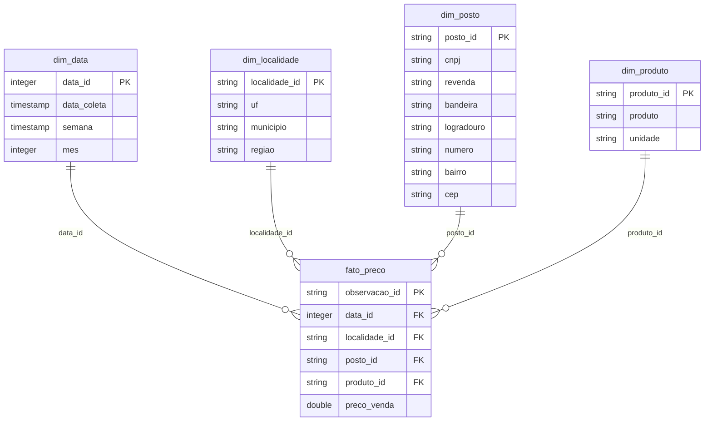

# Modelo dimensional e linhagem

## Grão

Uma linha da `fato_preco` representa uma observação de preço de um produto, em um posto (CNPJ), em uma data de coleta. A chave natural é CNPJ + produto + data. Duplicatas exatas são removidas; conflitos nessa chave interrompem o pipeline para revisão, em vez de escolher arbitrariamente um preço.

## Construção de chaves

IDs locais e de observação usam os primeiros 20 caracteres hexadecimais do SHA-256 das chaves concatenadas com `|`. O campo posto_id identifica uma versão dos atributos empresariais e de endereço; o mesmo CNPJ pode ter mais de uma versão. Nas comparações semanais, o agrupamento usa CNPJ, e não posto_id, para não duplicar a contagem. O pipeline valida unicidade e integridade no notebook.

## Linhagem

ANP / ZIP semestral original → CSV original → filtro DF/GO e DIESEL S10 → Bronze (recorte com strings e nulos) → tratamento explícito → dimensões e fato → preço mediano de cada posto-semana → indicadores de município-semana → cenários e recomendações.

O ZIP original permanece íntegro no volume da nuvem quando executado. URL, SHA-256, tamanho e horário de execução ficam no registro de auditoria. O CSV bruto e os microdados não são publicados no GitHub.

## Regras de negócio

1. Espaços externos são removidos; string vazia vira nulo.
2. CNPJ é texto com 14 dígitos. A validação é sintática e não consulta situação cadastral ou dígitos verificadores.
3. Data é interpretada estritamente como dia/mês/ano; preço usa vírgula decimal, convertido para número.
4. Datas fora do semestre, preço não positivo, CNPJ inválido, unidade diferente de R$ / litro, município ausente ou região divergente de CO são enviados à quarentena.
5. Preços fora de R$ 2–15/litro são sinalizados para revisão, não excluídos automaticamente. A faixa é alerta operacional, não limite físico nem tabela oficial.
6. Cada posto tem um voto por semana: usa-se sua mediana de coletas. A semana inicia na segunda-feira.
7. Indicadores são calculados por UF + município + semana. Exigem-se cinco postos distintos; semanas que atravessam as bordas do semestre são excluídas das comparações principais.
8. P25/P75 usam interpolação linear do pandas. Não são necessariamente preços oferecidos por um posto individual.
9. A avaliação da hipótese e o ranking de localidades exigem pelo menos 12 semanas elegíveis. O critério de suficiência foi acrescentado durante o desenvolvimento para evitar conclusão baseada em poucas semanas; a hipótese e suas perguntas originais foram preservadas.
10. Ranking de postos exige ≥12 semanas e cobertura de ≥75% das semanas elegíveis da localidade. Abaixo da mediana significa estritamente menor; empates não contam.
11. Médias semestrais dos indicadores dão peso igual às semanas elegíveis, não ao volume vendido. Comparações entre localidades usam cobertura distinta e não são um ranking de eficiência de gestão.
12. Economia potencial = litros hipotéticos × (mediana − P25). Não inclui deslocamento, contrato, capacidade, impostos adicionais ou custos de implantação. Não é economia causal nem realizada.

## Limite estatístico

O mínimo de cinco postos é uma regra prática de estabilidade, não garantia de representatividade. A composição da amostra pode mudar; evolução de mediana não isola inflação ou efeitos de gestão. Semanas sem cobertura não recebem imputação.
