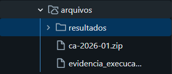
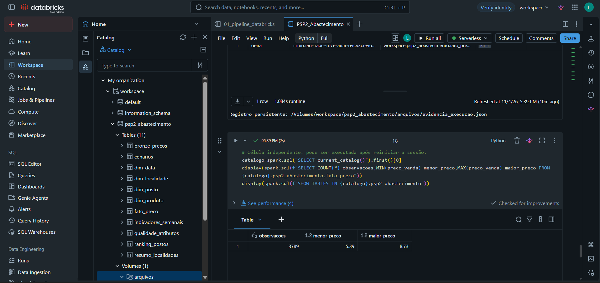

# Evidências da execução no Databricks

## Execução registrada

O aluno executou o notebook no Databricks e forneceu o arquivo [evidencia_execucao.json](evidencia_execucao.json), baixado do Volume. O arquivo foi conferido contra `resultados/auditoria.json` e `resultados/validacao_local.json` da execução local.

- **Data/hora:** 04/11/2026, 20:39:57 UTC = 17:39:57 de Brasília.
- **Ambiente:** Databricks; schema `workspace.psp2_abastecimento`.
- **Armazenamento de arquivos:** `/Volumes/workspace/psp2_abastecimento/arquivos`.
- **SHA-256 do ZIP:** `a2c95e5dfa324a9d7253d4e8d53022e0c08dcc5eb6f18551527ee9f29305c54c`, igual ao usado localmente.
- **Validações registradas:** contagens, unicidade de chaves primárias (PK) e integridade de chaves estrangeiras (FK) aprovadas.
- A interface do notebook também mostrou as nove células de código com estado de sucesso. O controle automatizado da interface é limitado pelo Databricks; a execução foi realizada manualmente pelo aluno.

O registro é produzido após as gravações em Delta e a releitura das tabelas. Ele constitui evidência de execução e persistência, mas não é uma assinatura criptográfica nem uma auditoria independente da plataforma.

## Tabelas gravadas e relidas

| Tabela | Linhas |
|---|---:|
| `bronze_precos` | 3789 |
| `dim_data` | 116 |
| `dim_localidade` | 17 |
| `dim_posto` | 305 |
| `dim_produto` | 1 |
| `fato_preco` | 3789 |
| `indicadores_semanais` | 380 |
| `resumo_localidades` | 17 |
| `ranking_postos` | 291 |
| `cenarios` | 954 |
| `qualidade_atributos` | 16 |

Há 305 versões descritivas de postos para 296 CNPJs distintos; isso é esperado pelo modelo. Os 380 pares município-semana incluem semanas de baixa cobertura ou borda; 318 atendem aos filtros da análise principal. Os 291 registros do ranking incluem candidatos não elegíveis; 104 atendem à cobertura exigida. Essas diferenças não indicam perda ou duplicação da fato.

## Evidência visual do Volume

Captura fornecida pelo aluno, mostrando o ZIP original, a pasta de resultados e o arquivo de evidência dentro do Volume:

## Notebook executado

[Abrir notebook no workspace Databricks](https://dbc-21b60f4e-9b9b.cloud.databricks.com/editor/notebooks/4238758834521223?o=7474660670040372). O link depende de autenticação e permissão no workspace; não torna o notebook público. A versão reproduzível do código está em `notebooks/PSP2_Abastecimento.ipynb` neste repositório.

## Consulta à tabela persistida

Captura fornecida pelo aluno: a célula final consulta a tabela `fato_preco` por SQL e retorna 3.789 observações, mínimo de R$ 5,39 e máximo de R$ 8,73. A navegação do catálogo mostra as 11 tabelas no schema do projeto e o Volume `arquivos`. Os valores coincidem com o processamento local.

## Limites da comprovação

- A captura comprova a consulta SQL à fato e a existência das tabelas no catálogo. Não documenta integralmente a saída de DESCRIBE DETAIL ou cada resposta analítica da interface.
- O reinício da sessão antes da consulta final não foi confirmado separadamente. A captura mostra a execução da célula final, sem permitir inferir que houve reinício.

Não se declara que houve reinício de sessão. As figuras do README foram geradas localmente com a mesma fonte e regras; não são capturas da interface Databricks.
